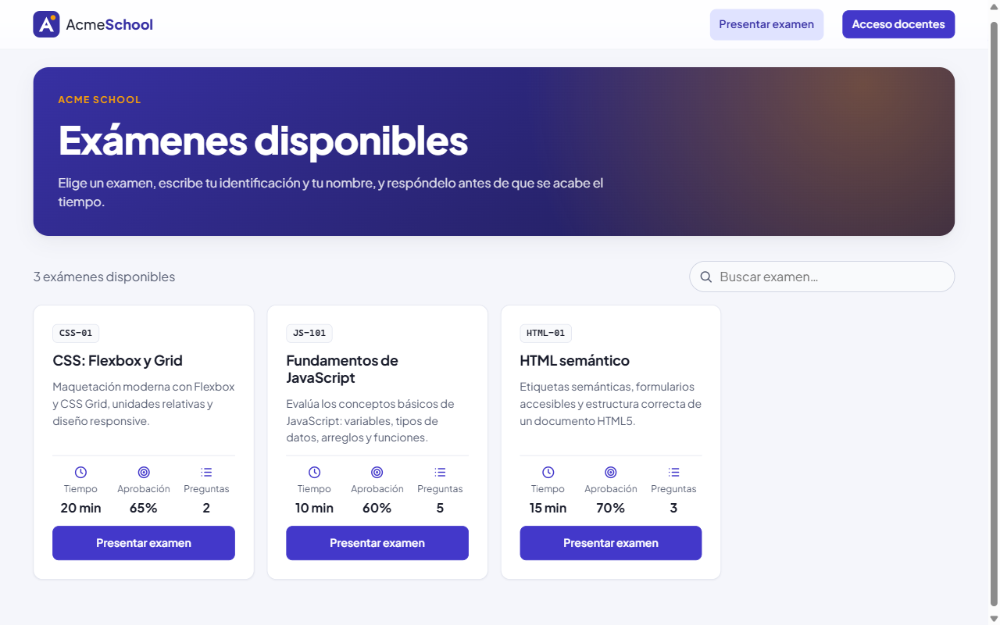
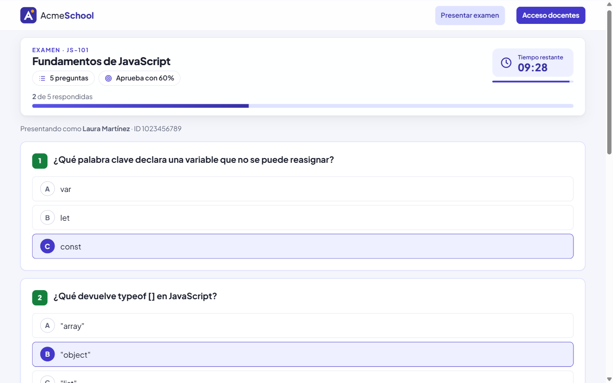
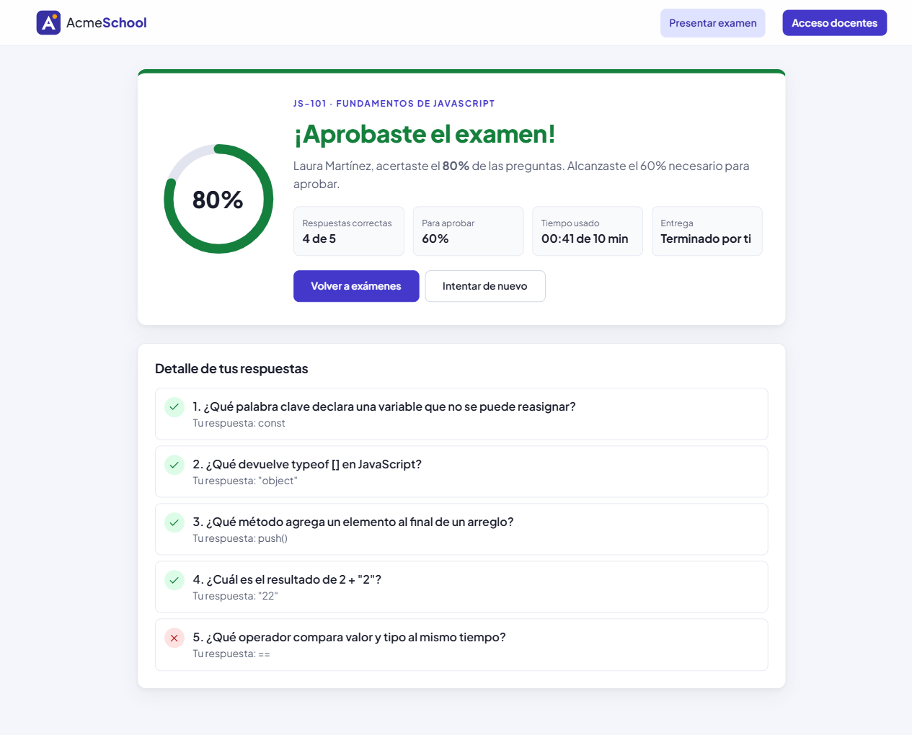
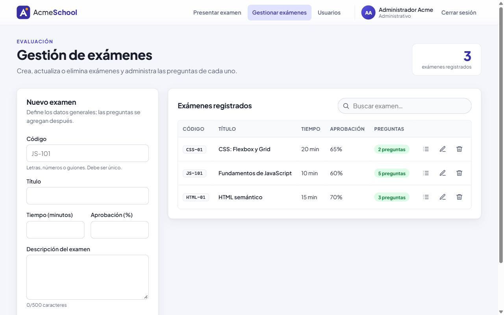
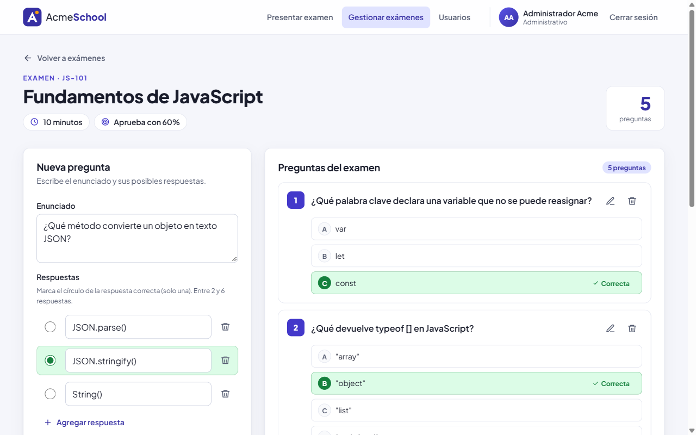
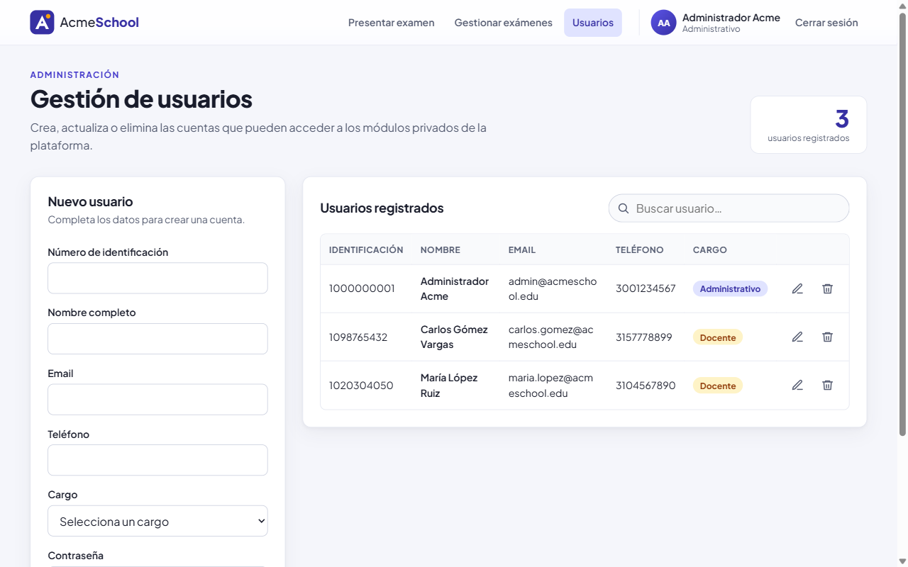
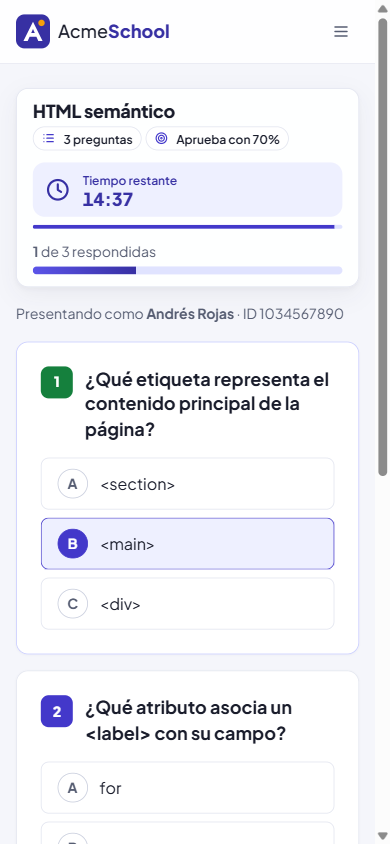

# Plataforma de exámenes · Acme School

Aplicación web hecha con **HTML, CSS y JavaScript puro (Web Components)** para que la escuela Acme gestione usuarios y exámenes, y para que sus estudiantes presenten los exámenes desde la web.

> Proyecto del skill de JavaScript. Toda la información se guarda en el navegador con `localStorage` en formato JSON.

## Estado del proyecto

| Fase | Contenido | Estado |
| --- | --- | --- |
| 1 | Estructura, sistema de diseño, persistencia, login y gestión de usuarios | ✅ Terminada |
| 2 | Gestión de exámenes, preguntas y respuestas | ✅ Terminada |
| 3 | Módulo público de resolución con reloj y resultados | ✅ Terminada |

## Flujo completo

1. Un usuario administrativo o docente inicia sesión (**Acceso docentes**).
2. En **Gestionar exámenes** crea un examen y le agrega preguntas con sus respuestas.
3. Cualquier estudiante, sin iniciar sesión, entra a **Presentar examen**, elige el examen y escribe su identificación y su nombre.
4. Responde las preguntas mientras corre el reloj y pulsa **Terminar** (o se entrega solo cuando el tiempo llega a 0).
5. Ve su porcentaje de respuestas acertadas y si aprobó o no.

## Wiki

La documentación detallada del proyecto (arquitectura, Web Components, router, modelo de datos, reloj, seguridad, accesibilidad y requisitos cumplidos) está en la wiki: https://github.com/andrewk-g/proyectocamilojs/wiki

## Capturas

### Exámenes disponibles



### Examen en curso con reloj en tiempo real



### Resultado



### Gestión de exámenes



### Preguntas y respuestas



### Gestión de usuarios



### En el celular



## Cómo ejecutarlo

La aplicación usa módulos de JavaScript (`type="module"`) y la Web Crypto API, por eso **debe abrirse desde un servidor local** (no con doble clic sobre el archivo):

1. Abre la carpeta del proyecto en Visual Studio Code.
2. Instala la extensión **Live Server**.
3. Clic derecho sobre `index.html` → **Open with Live Server**.

También sirve cualquier otro servidor estático, por ejemplo:

```bash
npx serve .
```

### Cuenta inicial

La primera vez que se abre la aplicación se crea automáticamente un administrador:

| Correo | Contraseña |
| --- | --- |
| `admin@acmeschool.edu` | `Admin1234` |

Desde el módulo de usuarios se pueden crear más cuentas (administrativos o docentes).

La primera vez también se crea un examen de ejemplo, **Fundamentos de JavaScript (JS-101)**, con 5 preguntas. Si se elimina, no vuelve a crearse.

## Módulos

### Resolución de exámenes (público)
No requiere iniciar sesión; es la página de inicio (`#/`).
- **Lista de exámenes disponibles**: muestra título, tiempo para resolverlo y porcentaje para aprobar de cada examen que tenga al menos una pregunta. Incluye buscador.
- **Datos del estudiante**: al elegir un examen se piden número de identificación y nombre completo; las respuestas quedan asociadas a esos datos.
- **Vista del examen**:
  - Encabezado fijo con el título, el número total de preguntas y el porcentaje para aprobar.
  - Reloj en tiempo real que empieza en los minutos asignados y termina en 0; cambia a ámbar y luego a rojo cuando queda poco tiempo.
  - Preguntas enumeradas con sus posibles respuestas; solo se puede elegir una por pregunta.
  - Barra de progreso de preguntas respondidas.
  - Botón **Terminar** para entregar antes de tiempo (si faltan preguntas, pide confirmación).
- **Tiempo agotado**: al llegar a 0 el examen se entrega automáticamente.
- **Resultado**: porcentaje de respuestas acertadas, mensaje de aprobación o no aprobación según el porcentaje configurado, respuestas correctas, tiempo usado y detalle de cada pregunta (acertada o no, sin revelar la respuesta correcta).
- **Robustez**: el examen en curso se guarda en `localStorage` con su hora límite. Si el estudiante recarga la página o sale y vuelve, continúa donde iba y el reloj sigue siendo exacto; si el tiempo se acabó mientras estaba fuera, se entrega al volver.

### Login
Vista inicial de los módulos privados. Valida correo y contraseña contra los usuarios registrados. Si alguien intenta entrar a una ruta privada sin sesión, se le envía al login y, al ingresar, vuelve a la ruta que pidió.

### Gestión de usuarios (privado)
- Tabla con los usuarios registrados y buscador por nombre, email o identificación.
- Formulario único para crear y actualizar.
- Botones para editar y eliminar cada registro (la eliminación pide confirmación).
- Validaciones: identificación numérica y única, email válido y único, teléfono, cargo (Administrativo o Docente) y contraseña de mínimo 8 caracteres con letras y números.
- No se puede eliminar la cuenta con la que se inició sesión.

### Gestión de exámenes (privado)
- Tabla con los exámenes registrados (código, título, tiempo, porcentaje de aprobación y número de preguntas) y buscador por código o título.
- Formulario único para crear y actualizar: código, título, tiempo en minutos, porcentaje de aprobación y descripción.
- Botones para gestionar las preguntas, editar y eliminar cada examen (la eliminación pide confirmación e indica cuántas preguntas se perderán).
- Validaciones: código único de 3 a 20 caracteres (letras, números o guiones), tiempo entero de 1 a 300 minutos, porcentaje entero de 1 a 100 y descripción de 10 a 500 caracteres.
- Al crear un examen se abre directamente su pantalla de preguntas.

### Preguntas y respuestas (privado)
Cada examen tiene su propia pantalla (`#/examenes/:id/preguntas`):
- Formulario con el enunciado y entre 2 y 6 respuestas, que se pueden agregar o quitar.
- Cada respuesta tiene una descripción y un selector para marcarla como correcta. Los selectores son botones de opción del mismo grupo, así que **solo una respuesta puede quedar marcada**; el servicio también lo valida antes de guardar.
- No se permiten respuestas vacías ni repetidas.
- Lista numerada de preguntas con la respuesta correcta resaltada y botones para editar o eliminar.

## Estructura del proyecto

```
├── index.html                 # Contenedor de la SPA
├── assets/                    # Favicon
├── capturas/                  # Capturas de pantalla del README y la wiki
├── css/
│   ├── variables.css          # Tokens de diseño (colores, tipografía, espaciado, movimiento)
│   ├── base.css               # Reset, tipografía y utilidades
│   ├── components.css         # Botones, formularios, tablas, toasts, modal, navbar
│   └── views.css              # Estilos de cada vista
└── js/
    ├── main.js                # Punto de entrada
    ├── router.js              # Router por hash con rutas privadas
    ├── data/
    │   ├── storage.js         # Lectura/escritura JSON en localStorage
    │   └── seed.js            # Administrador y examen de ejemplo iniciales
    ├── services/
    │   ├── auth.service.js    # Login, logout y sesión
    │   ├── users.service.js   # CRUD de usuarios
    │   ├── exams.service.js   # CRUD de exámenes y de sus preguntas
    │   └── attempts.service.js # Examen en curso, calificación y resultados
    ├── utils/                 # Validaciones, errores, formularios, cifrado, DOM e íconos
    ├── components/            # Web Components reutilizables
    │   ├── app-navbar.js
    │   ├── app-toast.js
    │   ├── app-confirm.js
    │   ├── user-form.js
    │   ├── user-table.js
    │   ├── exam-form.js
    │   ├── exam-table.js
    │   ├── question-form.js
    │   ├── question-list.js
    │   ├── exam-timer.js      # Reloj en tiempo real
    │   ├── exam-question.js   # Pregunta con opciones de respuesta
    │   └── score-ring.js      # Anillo animado con el porcentaje
    └── views/                 # Web Components que representan cada pantalla
        ├── public-exams-view.js
        ├── exam-runner-view.js
        ├── exam-result-view.js
        ├── login-view.js
        ├── users-view.js
        ├── exams-view.js
        └── exam-questions-view.js
```

## Estructura de datos (localStorage)

Cada colección se guarda como JSON con el prefijo `acme:`.

`acme:users`

```json
[
  {
    "id": "3f1c…",
    "identificacion": "1000000001",
    "nombre": "Administrador Acme",
    "email": "admin@acmeschool.edu",
    "telefono": "3001234567",
    "cargo": "Administrativo",
    "salt": "9a7e…",
    "passwordHash": "c41d…",
    "createdAt": "2026-11-23T22:00:00.000Z",
    "updatedAt": "2026-11-23T22:00:00.000Z"
  }
]
```

`acme:session`

```json
{ "userId": "3f1c…", "startedAt": "2026-11-23T22:05:00.000Z" }
```

Las contraseñas no se guardan en texto plano: se guarda un hash SHA-256 con una sal aleatoria por usuario.

`acme:exams`

```json
[
  {
    "id": "a46e…",
    "codigo": "JS-101",
    "titulo": "Fundamentos de JavaScript",
    "tiempo": 10,
    "porcentajeAprobacion": 60,
    "descripcion": "Evalúa los conceptos básicos de JavaScript…",
    "preguntas": [
      {
        "id": "9b2d…",
        "enunciado": "¿Qué palabra clave declara una variable que no se puede reasignar?",
        "respuestas": [
          { "id": "c1…", "descripcion": "var", "correcta": false },
          { "id": "c2…", "descripcion": "let", "correcta": false },
          { "id": "c3…", "descripcion": "const", "correcta": true }
        ]
      }
    ],
    "createdBy": "3f1c…",
    "createdAt": "2026-11-24T20:00:00.000Z",
    "updatedAt": "2026-11-24T20:10:00.000Z"
  }
]
```

`acme:activeAttempt` (examen que se está presentando)

```json
{
  "id": "0bc0…",
  "examId": "a46e…",
  "identificacion": "1122334455",
  "nombre": "Laura Pérez",
  "startedAt": 1795660000000,
  "deadline": 1795660600000,
  "respuestas": { "9b2d…": "c3…" }
}
```

`acme:attempts` (resultados guardados)

```json
[
  {
    "id": "0bc0…",
    "examId": "a46e…",
    "examCodigo": "JS-101",
    "examTitulo": "Fundamentos de JavaScript",
    "identificacion": "1122334455",
    "nombre": "Laura Pérez",
    "tiempoLimite": 10,
    "porcentajeAprobacion": 60,
    "correctas": 3,
    "total": 5,
    "porcentaje": 60,
    "aprobado": true,
    "finalizadoPor": "usuario",
    "startedAt": "2026-11-25T15:00:00.000Z",
    "finishedAt": "2026-11-25T15:04:12.000Z",
    "detalle": [
      { "preguntaId": "9b2d…", "enunciado": "¿Qué palabra clave…?", "respuestaId": "c3…", "respuestaTexto": "const", "acertada": true }
    ]
  }
]
```

El puntaje siempre lo calcula el servicio comparando cada respuesta elegida con la respuesta correcta guardada en el examen. El resultado guarda una copia del enunciado y de la respuesta elegida, así sigue siendo legible aunque después se edite o elimine el examen.

`acme:meta` guarda banderas internas, por ejemplo `{ "examsSeeded": true }`.

## Decisiones técnicas

- **Web Components** (`customElements.define`) para cada pieza de la interfaz: navbar, notificaciones, diálogo de confirmación, formulario, tabla y vistas.
- **Comunicación por eventos** (`CustomEvent`): el formulario y la tabla no se conocen entre sí; la vista los coordina.
- **Router por hash** con rutas públicas (`#/`, `#/presentar/:id`, `#/resultado/:id`), privadas (`#/examenes`, `#/examenes/:id/preguntas`, `#/usuarios`) y solo para invitados (`#/login`).
- **Reloj sin bloqueos**: no descuenta segundos con un contador; en cada tic calcula `horaLímite - ahora`. Así no se desfasa aunque el navegador ralentice los intervalos en segundo plano, y la interfaz nunca se congela.
- **Servicios separados de la interfaz**: los componentes nunca tocan `localStorage` directamente; validan y guardan a través de `users.service.js` y `exams.service.js`.
- **Accesibilidad**: HTML semántico, etiquetas en todos los campos, mensajes de error asociados con `aria-describedby`, foco visible, navegación por teclado, regiones `aria-live` y respeto de `prefers-reduced-motion`.
- **Responsive**: diseño mobile-first; en pantallas pequeñas la tabla se convierte en tarjetas y el menú se colapsa.
- **Seguridad básica**: todo texto ingresado por el usuario se escapa antes de mostrarse en pantalla.

## Identidad visual

- Primario: índigo `#4338ca` / `#3730a3`
- Acento: ámbar `#f59e0b`
- Tipografía: Plus Jakarta Sans
- Transiciones suaves de entrada en vistas, filas, notificaciones y diálogos.
